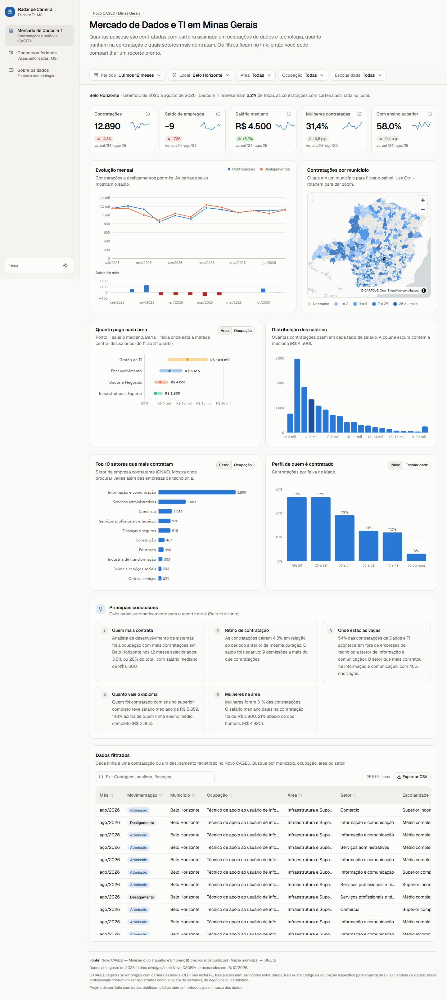
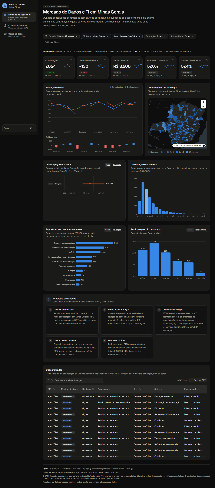
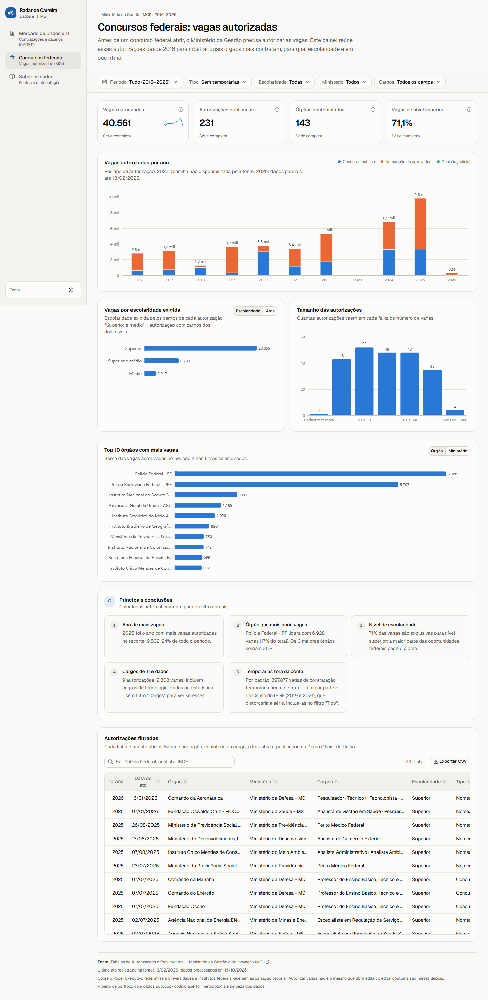
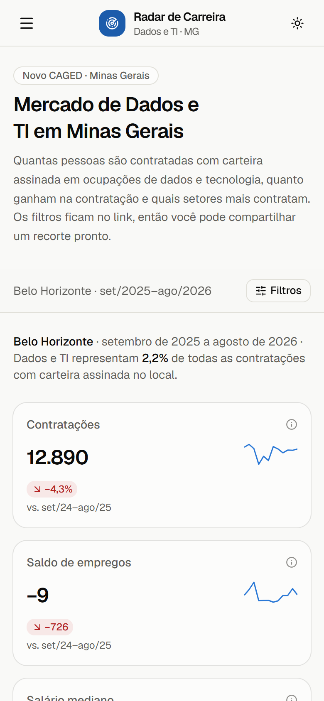

# Radar de Carreira em Dados — MG

**🔗 Acesse: [radar-carreira-dados.vercel.app](https://radar-carreira-dados.vercel.app)**

Painel interativo com **dados públicos oficiais** sobre o mercado de trabalho em **Dados e Tecnologia em Minas Gerais** (Novo CAGED) e sobre as **vagas autorizadas em concursos federais** (Ministério da Gestão).



<table>
  <tr>
    <td></td>
    <td></td>
    <td width="22%"></td>
  </tr>
  <tr>
    <td align="center">Modo escuro (MG · Dados e Negócios)</td>
    <td align="center">Concursos federais</td>
    <td align="center">Celular</td>
  </tr>
</table>

## Objetivo

Responder, com dados oficiais, perguntas de quem procura emprego na área:

- Quantas pessoas são **contratadas com carteira assinada** em ocupações de dados e TI, mês a mês?
- **Quanto se paga** na contratação, por área, ocupação e escolaridade?
- **Quais setores e cidades** mais contratam (além das empresas de tecnologia)?
- Quais órgãos federais mais **abrem vagas em concursos**, para qual escolaridade e em que ritmo?

## Funcionalidades

| | |
|---|---|
| **KPIs com variação** | 5 indicadores (contratações, saldo, salário mediano, % mulheres, % com ensino superior) comparados ao período anterior de mesma duração, com minilinha de tendência |
| **Visualizações** | evolução mensal + saldo, faixa salarial por área/ocupação, histograma de salários, top 10 setores/ocupações, perfil por idade/escolaridade, vagas por ano empilhadas por tipo, tamanho das autorizações, top 10 órgãos |
| **Mapa** | coroplético dos 853 municípios de MG (MapLibre); clique em um município filtra o painel inteiro |
| **Filtros globais na URL** | período (atalhos + intervalo livre), local, área, ocupação e escolaridade. Todo link é um recorte pronto para compartilhar — ex.: `/?local=mg&area=dados&de=2024-01&ate=2024-12` |
| **Tabela** | dados filtrados com busca, ordenação por coluna, rolagem virtualizada (centenas de milhares de linhas) e **exportação CSV** no formato do Excel brasileiro |
| **Principais conclusões** | 3 a 5 descobertas em linguagem simples, **recalculadas para o recorte atual** |
| **Design** | modo claro/escuro, paleta validada para daltonismo, skeleton no carregamento, estado vazio amigável, layout responsivo (filtros viram gaveta no celular) |

## Fontes dos dados

| Fonte | O que é | Período |
|---|---|---|
| [Novo CAGED](https://www.gov.br/trabalho-e-emprego/pt-br/assuntos/estatisticas-trabalho/novo-caged) — Ministério do Trabalho e Emprego ([FTP PDET](ftp://ftp.mtps.gov.br/pdet/microdados/NOVO%20CAGED/)) | Microdados de cada admissão e desligamento com carteira assinada | jan/2020 – ago/2026 |
| [Tabelas de Autorizações e Provimentos](https://www.gov.br/servidor/pt-br/observatorio-de-pessoal-govbr/autorizacoes-e-provimentos-concursos) — Ministério da Gestão e da Inovação (MGI) | Vagas autorizadas para concursos, nomeações e contratações temporárias do Executivo federal | 2016 – fev/2026 |
| [API de malhas e localidades](https://servicodados.ibge.gov.br/api/docs) — IBGE | Contornos e nomes dos municípios de MG | 2024 |

As bases originais ficam em [`data/raw/`](data/raw/):

- `caged_mg_dados_ti_original.csv.gz` — **recorte original e sem alterações** do CAGED (MG + 33 ocupações de Dados e TI, todas as colunas oficiais, 344 mil linhas), com uma coluna extra `arquivo_origem` indicando de qual arquivo do Ministério veio cada linha. Os arquivos nacionais completos somam ~3,5 GB e passam do limite do GitHub, por isso não são versionados.
- `caged_manifesto.json` — lista dos arquivos do CAGED já processados (nome e tamanho), usada pela atualização incremental.
- `concursos/` — as planilhas `.xlsx` exatamente como publicadas pelo MGI.
- `geo/` — as respostas da API do IBGE.

## Como foi feita a limpeza

### Novo CAGED (`scripts/caged_extrair.py` e `scripts/caged_painel.py`)

1. **Três arquivos por mês.** O Ministério publica as movimentações no prazo (`MOV`), fora do prazo (`FOR`) e as excluídas (`EXC`). As contagens seguem a metodologia oficial: **MOV + FOR − EXC**, pela competência da movimentação.
2. **Codificações diferentes.** Os arquivos `MOV` vêm em UTF-8 e os `FOR`/`EXC` em Latin-1. Os nomes de coluna são normalizados (removendo caracteres não-ASCII) para os dois casos chegarem ao mesmo nome.
3. **Recorte.** Ficam só as linhas de Minas Gerais (UF 31) nas 33 ocupações de [`scripts/grupos_cbo.csv`](scripts/grupos_cbo.csv), agrupadas em 4 áreas: Desenvolvimento, Dados e Negócios, Infraestrutura e Suporte, Gestão de TI. Não existe código CBO para "analista de BI" ou "cientista de dados"; esses profissionais costumam ser registrados como analista de sistemas, de negócios ou estatístico.
4. **Salário.** Entra nas estatísticas só para admissões com pagamento mensal, jornada ≥ 30 h/semana, sem contrato intermitente nem aprendiz, entre R$ 500 e R$ 100 mil (remove zeros e erros de digitação). Os valores são nominais.
5. **Outros campos.** Idades fora de 14–90 anos viram "não informada". Códigos de município, setor (seção CNAE), escolaridade, sexo e raça viram nomes pelo dicionário oficial do CAGED.
6. **Contexto.** O script também soma as admissões de *todas* as ocupações por município e mês, para mostrar quanto Dados e TI representam do total.
7. **Formato leve para o site.** O JSON final é **colunar** (uma lista por campo, com dimensões como índices): 344 mil linhas em 1,8 MB comprimidos, decodificadas em arrays tipados e filtradas no navegador em milissegundos.

**Validação:** o saldo total de empregos de MG em 2024 calculado pelo pipeline é **139.615**; o número oficial divulgado pelo Ministério do Trabalho é de **~139,5 mil** vagas.

### Concursos federais (`scripts/concursos.py`)

1. Cada planilha anual tem **colunas com nomes diferentes**; o script localiza a linha de cabeçalho e mapeia as colunas pelo nome.
2. Remove **linhas de total** e **duplicatas exatas**.
3. Converte vagas guardadas como texto ("1.000" → 1000). **"CR"** (cadastro reserva) vira 0 vaga, com marcação própria.
4. Agrupa os **mais de 20 textos de "tipo de autorização"** (inclusive com erros de digitação, como "Provimento Oringinal") em 4 categorias: concurso público, nomeação de aprovados, decisão judicial e contratação temporária.
5. **Extrai a data** do texto do ato ("12 de dezembro de 2017", "11. Março. 2016") ou, se não houver, do link do Diário Oficial.
6. Padroniza a escolaridade (NS/NI/NA) e marca **cargos de TI e dados** por palavras-chave.
7. **Contratações temporárias** ficam fora por padrão: o Censo do IBGE teve 234 mil vagas temporárias autorizadas em 2019 e 414 mil em 2021, o que esconderia o resto da série. É possível incluí-las no filtro "Tipo".
8. **2023 não tem planilha na fonte**: o link oficial desse ano abre a tabela de 2024. O ano aparece como lacuna no gráfico, com aviso.

## Stack e decisões técnicas

- **Next.js 16 (App Router) + TypeScript**: todas as páginas são **estáticas** (prontas para a Vercel, sem servidor). Os componentes que leem a URL ficam dentro de `<Suspense>`, como exige o Next 16 com Cache Components.
- **Tailwind CSS 4 + shadcn/ui**: layout e componentes (popover, command, sheet, toggle group...).
- **Apache ECharts 6** (renderizador SVG, só os módulos usados): suporta nativamente histograma, faixas e barras divergentes, com tooltips ricos. O tema dos gráficos lê os mesmos tokens CSS do site, então troca junto com o modo escuro.
- **MapLibre GL** + mapa-base CARTO (sem chave de API), carregado sob demanda.
- **nuqs** para os filtros na URL e **TanStack Virtual** para a tabela.
- **Python + Polars** no pipeline de dados: lê ~4,4 milhões de linhas por mês em segundos e guarda cache por mês, então a atualização mensal só processa o mês novo.
- **Paleta acessível**: as cores categóricas foram validadas para protanopia, deuteranopia e tritanopia nos dois temas. Mudanças positivas e negativas usam ícone (↑↓) além da cor, e todo gráfico tem legenda ou rótulos diretos.

## Estrutura do projeto

```
app/                     páginas: / (mercado), /concursos, /sobre
components/
  charts/                um componente por tipo de gráfico (linha, barras, faixas, colunas, empilhado, divergente, minilinha)
  map/                   mapa coroplético (MapLibre)
  dashboard/             KPI, card de gráfico, tabela, conclusões, estados vazio e de carregamento, rodapé
  filters/               barra de filtros, período, seleção única e múltipla
  mercado/ concursos/    composição de cada painel
  layout/                barra lateral, menu mobile, tema
lib/
  mercado/ concursos/    tipos, filtros (URL), cálculo dos indicadores e conclusões
  format.ts csv.ts       formatação pt-BR e exportação CSV
scripts/                 pipeline de dados (Python) e prints (Node)
data/raw/                bases originais
public/data/             JSON leves usados pelo site
docs/prints/             capturas de tela
```

## Como rodar

Requisitos: **Node.js 20+** e, para atualizar os dados, **Python 3.11+**.

```bash
npm install          # também copia o worker do MapLibre para public/vendor
npm run dev          # http://localhost:3000
npm run build        # build de produção
```

Os dados já processados estão em `public/data/`, então o site funciona sem rodar o Python.

## Atualização automática

Os dados se atualizam **sozinhos**: a GitHub Action [`.github/workflows/atualizar-dados.yml`](.github/workflows/atualizar-dados.yml) roda **toda segunda-feira** (e também sob demanda, no botão *Run workflow* da aba *Actions*):

1. consulta o FTP do CAGED e compara com `data/raw/caged_manifesto.json`;
2. baixa **só os arquivos novos** (~50 MB por mês), extrai o recorte de MG e apaga o bruto;
3. descobre os links das planilhas de concursos **na própria página oficial** (o nome do arquivo muda a cada atualização) e valida o ano pelo título de cada planilha;
4. regenera `public/data/*.json` e **faz commit só se algo mudou** — os arquivos são determinísticos, então semanas sem dados novos não geram commit;
5. o commit dispara um novo deploy na Vercel.

Se uma fonte falhar, as outras continuam, e a execução termina com erro para o GitHub avisar por e-mail. A atualização foi testada simulando um mês novo sem nenhum arquivo bruto local: o resultado ficou idêntico, byte a byte, ao processamento completo.

O CAGED é divulgado cerca de 30 dias após o fim de cada mês; as tabelas de concursos, sem periodicidade fixa.

### Atualizar manualmente

```bash
python -m venv .venv
.venv\Scripts\activate            # Windows  (Linux/macOS: source .venv/bin/activate)
pip install -r scripts/requirements.txt

python scripts/atualizar.py       # ou: npm run dados
```

Opcional: `python scripts/caged_baixar.py` espelha o FTP inteiro do CAGED em `data/raw/caged/` (~3,5 GB, fora do Git). Com o espelho, um reprocessamento completo não precisa baixar nada.

Para regerar os prints: com o site rodando, `node scripts/prints.mjs http://localhost:3000` (usa o Chrome instalado e também verifica erros no console e rolagem horizontal).

## Deploy na Vercel

1. Suba o repositório para o GitHub.
2. Em [vercel.com/new](https://vercel.com/new), importe o repositório. O framework (Next.js) é detectado sozinho e não há variáveis de ambiente.
3. Cada push na branch principal publica uma nova versão.

## Limitações

- O CAGED cobre só emprego **formal CLT**: não inclui PJ, freelancers nem servidores estatutários.
- **Contratação não é vaga anunciada**: o CAGED registra quem foi efetivamente contratado.
- **Autorização não é edital**: o edital costuma sair meses depois. A tabela do MGI não inclui universidades e institutos federais.
- O último ano de cada fonte é parcial. Os salários são nominais, sem correção pela inflação.

---

Projeto de portfólio · dados públicos sob a [Lei de Acesso à Informação](https://www.planalto.gov.br/ccivil_03/_ato2011-2014/2011/lei/l12527.htm).
